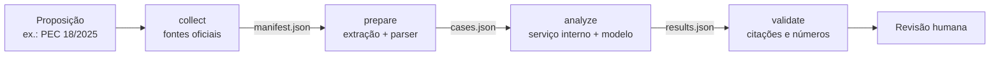

# Análise de emendas e destaques

Núcleo de referência, em Python, de um fluxo que prepara a análise de **destaques e emendas** a proposições em votação no Plenário da Câmara dos Deputados. O repositório descreve e executa o processamento: coleta nas fontes oficiais, extração de texto (com OCR), parser determinístico dos dispositivos atingidos, recorte literal do texto-base e contrato da etapa de redação por modelo de linguagem. Foi escrito para dar à DITEC os requisitos técnicos de uma solução interna equivalente ao fluxo que hoje roda em ambiente pessoal.

Não é sistema oficial e não decide nada sobre a votação. Todo resultado passa por revisão humana.

## O problema

Durante a votação, a Mesa precisa saber, para cada destaque e cada emenda: **qual dispositivo** é atingido, **o que muda** no texto e se o destaque **é admissível** pelo Regimento (RICD, art. 162, IV e V). Os documentos chegam como PDFs gerados por sistemas diferentes, com redação livre do autor, e o texto em votação costuma ser um substitutivo que mudou várias vezes. Errar o dispositivo (`§ 2º` em vez de `§ 2º-B`) ou a operação (tratar um destaque de emenda como supressão) inverte a informação dada à Mesa.

## Como funciona



| Etapa | O que faz | Saída | Código |
| --- | --- | --- | --- |
| `collect` | resolve a proposição na API da Câmara (e no Senado, para MPV), baixa destaques, emendas, pareceres, substitutivos e texto principal, com hash e data | `manifest.json` | `collect.py` |
| `prepare` | extrai o texto (PDF, DOCX, OCR), identifica modo e operação de cada objeto pelo RICD, lê os dispositivos atingidos e recorta o trecho literal na versão mais recente do texto-base | `cases.json` | `extract.py`, `references.py`, `parser.py` |
| `analyze` | envia cada caso, só com as evidências, a um serviço de análise na rede interna, que chama o modelo de linguagem homologado | `results.json` | `analyze.py` |
| `validate` | confere schema, citações, números e coerência com o objeto; nada é aprovado automaticamente | `validation.json` | `analyze.py` |

As duas primeiras etapas são determinísticas e não usam modelo de linguagem.

## Exemplo de entrada e saída

Requerimento de destaque, no formato gerado pelo sistema da Câmara (trecho):

```text
Requeiro a V. Exa., nos termos do art. 161, I, do Regimento Interno da Câmara dos Deputados, destaque para
votação em separado do(a) expressão "antes da decisão" constante do art. 6º, caput, do substitutivo, e, por
decorrência, a expressão "em até 30 dias", constante do § 1º deste mesmo artigo do substitutivo
```

O que o parser entrega (resumido de `cases.json`):

```text
mode = dvs          operation = supressao_pretendida      ricd_basis = art. 161, I
alvo 1: art. 6, caput, expressão "antes da decisão"   (substitutivo)
alvo 2: art. 6, § 1º, expressão "em até 30 dias"       (substitutivo)
evidência: "Art. 6º O órgão comunicará a decisão ao interessado antes da decisão."  [PRLP-2, bloco 15, 579–648]
evidência: "§ 1º A comunicação ocorrerá em até 30 dias, por meio eletrônico."      [PRLP-2, bloco 16, 650–714]
```

O recorte veio do parecer de plenário mais recente (PRLP 2); a versão anterior (PRLP 1) fica registrada quando tem redação diferente. Cada evidência é uma fatia exata do texto extraído, localizável no documento original.

## Para rodar

Requer Python 3.12 ou superior. Para PDF digitalizado, Tesseract com o idioma `por` (no Windows, aponte o executável em `TESSERACT_CMD`).

```bash
python -m venv .venv && source .venv/bin/activate          # Windows: .venv\Scripts\activate
python -m pip install -e '.[test]'
python -m pytest -q                                         # 68 testes, sem rede

# lote fictício que cobre todos os modos
python examples/build_synthetic_inputs.py work/demo_input
analise-legislativa collect --input-dir work/demo_input --workspace work/demo
analise-legislativa prepare --workspace work/demo           # gera work/demo/cases.json

# proposição real, direto das fontes oficiais
analise-legislativa collect --proposicao "PL 5229/2025" --workspace work/pl5229
analise-legislativa prepare --workspace work/pl5229
```

Para a etapa semântica, suba o analisador de referência apontando para o modelo homologado e rode `analyze` e `validate` ([documento 4](docs/04-analise-semantica.md#45-analisador-de-referência)):

```bash
LLM_BASE_URL=http://llm.interno/v1 LLM_MODEL=nome-do-modelo python examples/analisador_referencia.py &
ANALYZER_URL=http://localhost:8080/analyze analise-legislativa analyze --workspace work/demo
analise-legislativa validate --workspace work/demo
```

## O que o parser reconhece

- **Tipo de destaque** pelo inciso do art. 161 do RICD citado no requerimento (I: votação em separado de parte da proposição; II: destaque de emenda), com o tipo oficial do documento como reserva.
- **Vínculo destaque → emenda** por ID oficial, por sigla e número ou por número único; ambiguidades (EMP 4 e EMC 4) vão para revisão.
- **Dispositivos** com sufixo (`§ 2º-F`, `art. 144-A`, `inciso XLVI-A`, `art. 1º-1`), listas e intervalos (`§§ 2º-C a 2º-E`, `incisos I a VII`), cadeias ("alínea 'a', do inciso II, do § 8º-A, do art. 144"), caput, parágrafo único, expressões entre aspas, norma alterada ("do Decreto-Lei nº 1.804, de 1980") e artigo contenedor ("no art. 1º da PEC").
- **Comandos de emenda** imperativos e declarativos ("Dê-se…", "Acrescente-se…", "Suprima-se…", "… passa a vigorar acrescido do inciso…"), redação parcial com linhas pontilhadas e artigo novo "onde couber".
- **Versões do texto-base**: usa a mais recente (o substitutivo em votação costuma estar dentro do parecer de plenário) e avisa quando uma versão mais recente está ilegível.

Validação com dados reais: PL 5229/2025, PEC 18/2025 e MPV 1357/2026, 187 casos, 1 com revisão por inconsistência do próprio requerimento ([documento 6](docs/06-validacao-aceite-e-limites.md#62-validação-com-proposições-reais)).

## Documentação

1. [Conceitos do processo legislativo para a equipe de TI](docs/01-conceitos-legislativos.md): siglas, RICD, dispositivos, anatomia de requerimentos e emendas, armadilhas reais.
2. [Coleta e proveniência](docs/02-coleta-e-proveniencia.md): endpoints, regras de rede, manifesto, sidecars, redação vigente.
3. [Extração e parser determinístico](docs/03-extracao-e-parser.md): todas as regras, com exemplos de entrada e saída.
4. [Análise semântica](docs/04-analise-semantica.md): o que vai ao modelo, regras de redação, veredito do RICD, contrato HTTP, analisador de referência, validação.
5. [Infraestrutura e operação](docs/05-infraestrutura-e-operacao.md): componentes, ambiente, configuração, comandos, recuperação, capacidade.
6. [Validação, aceite e limites](docs/06-validacao-aceite-e-limites.md): testes, resultados com proposições reais, critérios de aceite, diferenças em relação ao fluxo original.

Contratos: [`openapi.yaml`](docs/openapi.yaml) e os JSON Schemas em [`src/analise_legislativa/schemas`](src/analise_legislativa/schemas). Referência das fontes: [API de Dados Abertos da Câmara](https://dadosabertos.camara.leg.br/swagger/api.html) e [dados abertos do Senado](https://legis.senado.leg.br/dadosabertos).

## Mapa do repositório

```text
src/analise_legislativa/
  collect.py      coleta oficial e local, manifesto
  extract.py      PDF, DOCX, OCR, posições e evidências
  references.py   leitura de dispositivos e de comandos de emenda
  parser.py       modo, vínculo, localização no texto-base, avisos (gera cases.json)
  analyze.py      contrato do serviço de análise, instruções, checkpoint, validação
  cli.py          comando analise-legislativa
  schemas/        manifest, case, analysis, result (JSON Schema 2020-12)
examples/
  build_synthetic_inputs.py   lote fictício no formato dos documentos reais
  analisador_referencia.py    serviço POST /analyze que chama um modelo compatível com Chat Completions
tests/            68 testes, sem rede
docs/             documentação detalhada e openapi.yaml
```
