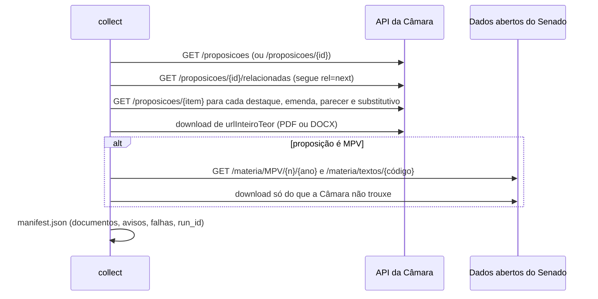

# 2. Coleta e proveniência

A etapa `collect` (`src/analise_legislativa/collect.py`) obtém os documentos e grava `manifest.json`: o que foi obtido, de onde, quando, com que hash, e o que falhou. Nenhuma decisão de conteúdo é tomada aqui. A escolha da versão do texto-base, por exemplo, fica para o parser.

## 2.1 Entradas aceitas

| Forma | Exemplo | Resolução |
| --- | --- | --- |
| sigla número/ano | `PL 5229/2025`, `PEC 18/2025`, `MPV 1357/2026` | `GET /proposicoes?siglaTipo=&numero=&ano=&itens=100`; exige resultado único |
| ID da Câmara | `2572690` | `GET /proposicoes/{id}` |
| URL da ficha | `…/fichadetramitacao?idProposicao=2572690` ou `…/propostas-legislativas/2572690` | extrai o ID |
| URL da MPV no Congresso | `…congressonacional.leg.br/materias/medidas-provisorias/-/mpv/174123` | o número é o **código da matéria** no Senado: `GET /materia/174123` devolve sigla, número e ano, e só então a Câmara é consultada |
| pasta local | `--input-dir pacote/` | PDFs e DOCXs com sidecar opcional (seção 2.6) |

## 2.2 Sequência da coleta oficial

1. **Relacionadas.** `GET /proposicoes/{id}/relacionadas` é chamado **sem** o parâmetro `itens`, que esse endpoint rejeita. Os links `rel=next` são seguidos por precaução. Cada item recebe um papel pela sigla (`role_for`, tabela no [documento 1](01-conceitos-legislativos.md#12-documentos-e-siglas)). Itens sem papel (requerimentos comuns, por exemplo) ficam fora.
2. **Detalhe de cada item.** `GET /proposicoes/{item}` fornece `urlInteiroTeor`, `dataApresentacao`, `descricaoTipo` e `ementa`. Os três últimos vão para `metadata`: `date` em ISO 8601, `type_description` e `description`.
3. **Texto principal.** O inteiro teor da própria proposição entra com papel `texto_principal`.
4. **Complemento de MPV.** Emendas e pareceres de medida provisória são da comissão mista e às vezes só existem nos dados abertos do Senado. A regra segue o fluxo original e cobre **apenas o que a Câmara não trouxe** (`select_congress_documents`):
   - emendas citadas nos destaques já baixados cujo número ainda não está no lote; com `--all-congress-amendments`, todas as ausentes;
   - um único parecer, se a Câmara não trouxe nenhum, escolhido por classe (Parecer > Relatório Legislativo > PLV) e depois por data. "Listagem ou relatório descritivo" é lista de presença e é descartada.

   Baixar a mesma emenda das duas fontes criaria duas candidatas com a mesma sigla e o mesmo número, e o vínculo do destaque ficaria ambíguo.

Na validação com a MPV 1357/2026, a própria Câmara trouxe as 112 emendas da comissão mista, o parecer e o PLV 13. O Senado não precisou complementar nada.

## 2.3 Regras de rede

| Regra | Implementação | Motivo |
| --- | --- | --- |
| Só domínios oficiais | `*.camara.leg.br`, `*.senado.leg.br`, `*.congressonacional.leg.br` (`official_url`) | a URL de inteiro teor vem da resposta da API e não é confiável por si |
| HTTP de domínio oficial vira HTTPS | `official_url` | a API do Senado devolve `UrlTexto` com `http://`; sem a promoção, o complemento de MPV nunca seria baixado |
| Redirecionamento conferido a cada salto | `OfficialClient.get` (até 6 saltos) | impede que um 302 leve a outro domínio |
| Conteúdo conferido pela assinatura | `%PDF` ou `PK\x03\x04` (DOCX) | um `200 OK` com página HTML não vira documento |
| Novas tentativas | até 3 para 429 e 5xx (respeita `Retry-After` numérico até 30 s; senão 1, 2 e 4 s) e para falha de rede | a API da Câmara oscila em dia de votação |
| Ritmo | 0,5 s entre requisições (`OfficialClient(interval=…)`) | cortesia com a fonte pública |

O cliente usa o `User-Agent` padrão do `httpx`, e a coleta real de PL, PEC e MPV funcionou com ele. O fluxo original usava `urllib` com `User-Agent` de navegador porque o endereço `prop_mostrarintegra` recusava o agente padrão do `urllib`. Se um proxy ou WAF institucional recusar o cliente, basta ajustar os cabeçalhos em `OfficialClient.get`.

## 2.4 `manifest.json`

| Campo | Conteúdo |
| --- | --- |
| `run_id` | hash da proposição, dos pares (`source_id`, `sha256`) e da versão do pacote; muda se qualquer documento mudar |
| `proposition` | `id`, `sigla`, `numero`, `ano` |
| `documents[]` | um registro por documento obtido (tabela abaixo) |
| `warnings[]` | avisos legíveis, por exemplo: "camara:444 (SBT 1): inteiro teor não informado pela fonte" |
| `failures[]` | as mesmas falhas, estruturadas: `source_id`, `role`, `kind`, `number`, `date`, `reason` |

Cada documento:

| Campo | Exemplo | Uso |
| --- | --- | --- |
| `source_id` | `camara:2643555`, `congresso:10222142`, `local:<hash>` | identidade do objeto; distingue os dois "DTQ 1" de uma PEC com duas rodadas |
| `role` | `destaque`, `emenda`, `parecer`, `substitutivo`, `texto_principal`, `apoio` | decide o que vira caso e onde buscar o texto-base |
| `kind`, `number`, `year` | `DTQ`, `4`, `2026` | identidade legislativa |
| `url` | URL oficial do inteiro teor | proveniência |
| `path`, `sha256`, `retrieved_at` | `sources/camara-2643555-DTQ-4.pdf` | integridade; `prepare` e `validate` recusam arquivo com hash diferente |
| `metadata` | `date`, `description`, `type_description`, `proposition` | contexto, nunca prova |

As falhas ficam estruturadas porque o parser precisa saber se uma versão ausente **poderia** ser o texto em votação. Um substitutivo mais recente que não pôde ser lido bloqueia os casos que dependem dele; a falha de um documento sem relação com o caso fica só no nível do lote ([documento 3](03-extracao-e-parser.md#36-avisos-e-notas)).

O manifesto é escrito de forma atômica (arquivo temporário seguido de `os.replace`), e os caminhos usam `/` em qualquer sistema operacional.

## 2.5 Entrada local

`collect --input-dir` copia cada PDF ou DOCX para `sources/` com o hash no nome e lê um sidecar opcional. Formato próprio, `<arquivo>.meta.json`:

| Campo | Exemplo | Observação |
| --- | --- | --- |
| `source_id` | `camara:2643555` ou `local:dtq-2` | sem ele, `local:<hash>` |
| `role` | `destaque` | sem sidecar, vem da sigla no nome do arquivo |
| `kind`, `number`, `year` | `DTQ`, `2`, `2026` | |
| `date` | `2026-03-10` ou `10/03/2026 15:00` | normalizada para ISO; ordena as versões |
| `description` | ementa | |
| `proposition` | `{"id": null, "sigla": "PL", "numero": 100, "ano": 2026}` | |
| `url` | URL oficial | proveniência |
| `vinculo` | `{"emenda": {"id": 2638323}}` | vínculo oficial do destaque com a emenda; vence a leitura do texto |
| `law_ref` | `Decreto-Lei 1804/1980` | marca a cópia da redação vigente de uma norma (seção 2.6) |

Também é aceito o sidecar `<arquivo>.camara_meta.json`, que o fluxo original grava ao baixar o pacote da Câmara. Os campos `id`, `siglaTipo`, `numero`, `ano`, `papel`, `dataApresentacao`, `ementa`, `url_inteiro_teor`, `proposicao_principal` e `vinculo` são convertidos para o formato acima, o que permite processar aqui uma pasta montada pelo fluxo original.

Sem sidecar, o papel é inferido pela sigla no início do nome (`DTQ-1-…`, `EMP-2…`). O documento recebe `metadata.inferred_role`, o caso vai para revisão, e um nome sem sigla vira `apoio`. O nome do arquivo não prova a identidade de um documento.

## 2.6 Redação vigente da norma alterada

Quando uma emenda altera um dispositivo que a proposição não toca (um artigo de lei vigente, por exemplo), não há "antes" no texto-base. O fluxo original buscava a redação vigente no Planalto no momento da análise. Aqui a captura é explícita e rastreável:

1. salve a página ou o PDF da lei (por exemplo, do Planalto) na pasta de entrada;
2. crie o sidecar com `role: "apoio"`, `law_ref` na forma canônica (`"Decreto-Lei 1804/1980"`, `"Lei 9363/1996"`, `"Constituição Federal"`), `url` e `date`;
3. em `prepare`, todo dispositivo cuja `amended_norm` coincide com o `law_ref` ganha uma evidência `redacao_vigente` recortada dessa cópia.

Documentos com `law_ref` nunca entram na busca do texto em votação: são o "antes", e não o texto da proposição.

## 2.7 O que a coleta não faz

- **Não escolhe versão.** Todas as versões de parecer e substitutivo são guardadas; o parser usa a mais recente e registra as anteriores que diferem.
- **Não raspa HTML.** O fluxo original tinha um último recurso: ler a página `prop_destaques` quando `/relacionadas` não trazia destaques. Ele não foi reproduzido, porque a página não tem contrato estável. A implementação institucional pode acrescentá-lo como fonte com `source_id` próprio.
- **Não baixa todas as emendas de MPV por padrão.** Só com `--all-congress-amendments`.
- **Não interpreta lista vazia como ausência.** Sem destaques nem emendas, o aviso diz "não presumir inexistência": destaques costumam ser apresentados perto da votação.
