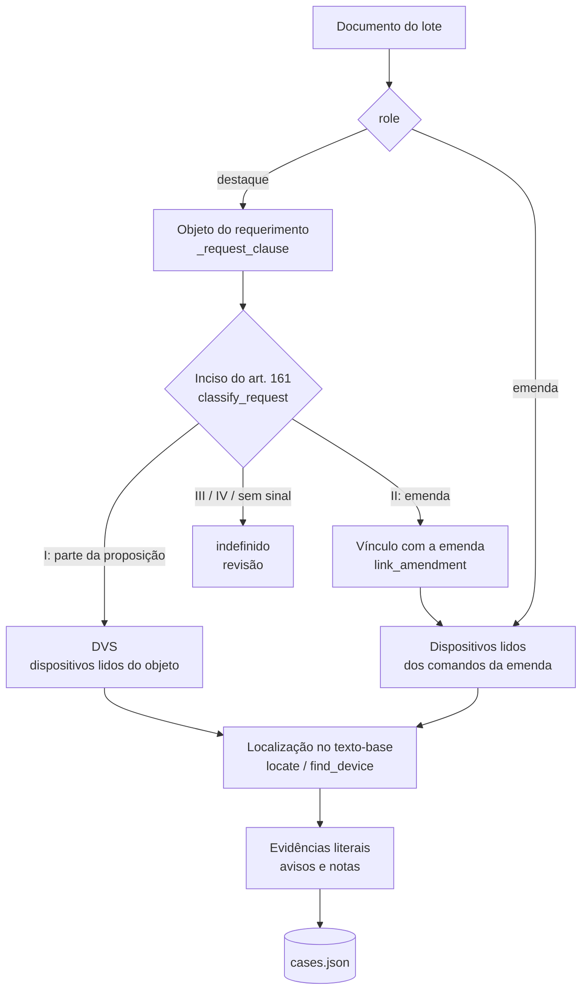

# 3. Extração e parser determinístico

A etapa `prepare` (`src/analise_legislativa/parser.py`) lê o manifesto e grava `cases.json`, com um caso por destaque ou emenda. Cada caso traz o modo, a operação pretendida, os dispositivos atingidos, os recortes literais do texto-base e os avisos. Nenhum modelo de linguagem participa desta etapa, e o mesmo lote produz sempre o mesmo resultado.

## 3.1 Extração de texto (`extract.py`)

| Formato | Como é lido |
| --- | --- |
| PDF com texto | PyMuPDF (`get_text("text", sort=True)`) e pypdf; fica a extração mais completa |
| PDF digitalizado | se a camada de texto está vazia ou tem média abaixo de 100 caracteres por página, cada página é renderizada a 220 dpi e passa pelo Tesseract com o idioma `por`; o OCR só substitui o texto nativo se recuperar mais conteúdo |
| DOCX | elementos do corpo na ordem do documento, inclusive linhas de tabela (células unidas por " \| "); pareceres de gabinete costumam chegar em Word |
| DOC (binário antigo) | recusado: converter para DOCX |

- **Tesseract.** O executável vem de `TESSERACT_CMD` ou do PATH. A saída é lida como UTF-8: com a codificação padrão do Windows (cp1252), a página OCR seria perdida.
- **Carimbo de autenticação.** As linhas que o Infoleg repete em toda página (`*CD…*`, "Apresentação: dd/mm/aaaa hh:mm…", "DTQ 4 => PL 5229/2025", "Assinado eletronicamente pelo(a)…", "Para verificar a assinatura…") são removidas antes da indexação (`STAMP_LINE`). No PL 5229/2025, esse carimbo caía entre o caput e o § 1º do art. 5º do substitutivo.
- **Posições.** O texto do documento é a concatenação das páginas (ou blocos do DOCX), separadas por uma linha em branco. Cada segmento guarda `page` ou `block` e o intervalo `[start, end)`. Uma **evidência** é sempre uma fatia exata desse texto: `quote == text[start:end]`, com `evidence_id = sha256(source_id, start, end)[:20]`. `validate` extrai o arquivo de novo e confere fatia e página; um revisor encontra o trecho no PDF original pela página.

## 3.2 Visão geral



## 3.3 Destaques: objeto, modo e vínculo

**Objeto do requerimento (`_request_clause`).** É o trecho depois do último "destaque para votação em separado do(a)" ou "destaque para", até "JUSTIFICAÇÃO", "Sala das Sessões", "Sala das Reuniões", "com a finalidade" ou "Brasília,". Com isso ficam de fora o cabeçalho, a referência ao art. 161 do RICD (que, de outro modo, seria lida como dispositivo), a justificação e o rodapé.

**Modo e operação (`classify_request`).** As regras são avaliadas nesta ordem:

1. inciso III ou IV do art. 161 → `indefinido`, com aviso (projeto autônomo e preferência estão fora do escopo);
2. o objeto cita emenda ("EMP 1", "EMC 10", "Emenda nº 96", "emenda 04"), ou o inciso é o II → `destaque_emenda` / `inclusao_emenda`; se o requerimento citar o inciso I, há aviso de inconsistência;
3. inciso I, ou "votação em separado" → `dvs` / `supressao_pretendida`;
4. nenhum sinal → `indefinido`, com aviso.

Sem citação do inciso, vale o tipo oficial do destaque: o título do PDF ("DESTAQUE DE EMENDA", "DESTAQUE PARA VOTAÇÃO EM SEPARADO", "DESTAQUE DE PREFERÊNCIA") ou o `descricaoTipo` da API. A regra 2 corrige um erro clássico: um destaque de emenda cuja emenda não está no lote seria tratado como supressão de dispositivo.

**Vínculo com a emenda (`link_amendment`).**

| Situação | Resultado |
| --- | --- |
| sidecar com `vinculo.emenda.id` presente no lote | essa emenda, por ID oficial |
| sigla e número ("EMP 1") com candidata única | essa emenda |
| só o número ("Emenda nº 96") com candidata única | essa emenda |
| mais de uma candidata (EMP 4 e EMC 4) | nenhuma, com aviso de vínculo ambíguo |
| nenhuma candidata | nenhuma, com aviso: "EMC 96 destacada não está no lote" |

O texto produzido pelo modelo nunca cria vínculo. Destaque de **parte** da emenda ("artigo 144 da emenda 04") vira dispositivo do próprio destaque. Ele é recortado do texto da emenda (evidência `emenda_vinculada`) e também procurado no texto-base, para dar o contexto atual.

**Texto-alvo (`text_role`).** O alvo é `substitutivo` só quando o próprio documento o diz ("do substitutivo", "ao substitutivo", "pelo Projeto de Lei de Conversão"). "Emenda substitutiva" não conta. Menção a substitutivo apenas no parecer também não. É a mesma regra do fluxo original. A busca do recorte, porém, procura nos dois textos (seção 3.5).

## 3.4 Leitura de referências e comandos (`references.py`)

**Tokens reconhecidos (`tokens`).**

| Nível | Formas aceitas | Valor normalizado |
| --- | --- | --- |
| artigo | `art. 5º`, `Art 1º`, `artigo 144`, `arts. 3º a 8º`, `arts. 21, 22 e 144`, `art. 144-A`, `art. 1º-1`, `art. 1o` | `"5"`, `"3"…"8"`, `"144-A"`, `"1-1"` |
| parágrafo | `§ 2º`, `§2°`, `§ 2º-F`, `§§ 8º, 8º-A e 14`, `§§ 2º-C a 2º-E`, `§º 7-A`, `parágrafo 8-A`, `§ 8º-`+quebra de linha+`A` | `"2"`, `"2-F"`, `"2-C"…"2-E"` |
| parágrafo único | `parágrafo único` | `"unico"` |
| inciso | `inciso II`, `incisos IV, V e IX`, `incisos I a VII`, `inciso XLVI-A`, `Inciso XLVI- A` | `"II"`, `"I"…"VII"`, `"XLVI-A"` |
| alínea | `alínea a`, `alínea 'a'`, `alíneas “a” e “b”` | `"a"`, `"b"` |
| item | `item 1` (só quando seguido de "da alínea" ou "do inciso"; "Item 1 –" de emenda de MPV não é dispositivo) | `"1"` |
| caput | `caput` | `caput = true` |
| expressão | `expressão "…"`, `termo “…”`, `palavra '…'` | o texto entre aspas; o conteúdo é mascarado antes da leitura, e os números dentro da expressão não viram dispositivo |

**Montagem dos dispositivos (`resolve`).**

1. Subdispositivos pendentes recebem o próximo artigo ligado por preposição. Em "o inciso II e os §§ 2º, 2º-A e 11 **do** art. 144", o inciso e os três parágrafos são do art. 144.
2. Em cadeia, o nível superior completa o inferior. Em "alínea 'a', do inciso II, do § 8º-A, do art. 144", sai um único dispositivo com quatro níveis.
3. Depois de um artigo citado de frente, vírgula ou preposição introduzem descendente: "art. 5º, § 2º"; "Art. 144, paragrafo 8-A, inciso I"; "O art. 22 da CF passa a vigorar acrescido do inciso XXXII".
4. Artigo seguido de "da PEC", "da Proposta", "do substitutivo", "da Medida Provisória" ou "da emenda":
   - é **contenedor** quando já há dispositivo na frase ("inciso VIII ao art. 144 da CF, **no art. 1º da PEC**");
   - é o **próprio alvo** quando não há ("Dê-se ao art. 1º da PEC a seguinte redação"; "artigo 144 da emenda 04").
5. "deste mesmo artigo" reaproveita o último artigo citado.
6. A norma alterada é a primeira citada depois do dispositivo ("…do art. 1º **do Decreto-Lei nº 1.804, de 3 de setembro de 1980**" → `Decreto-Lei 1804/1980`). "Projeto de Lei nº 5.229" não é norma alterada.

Exemplos reais (todos cobertos por teste):

| Cláusula | Dispositivos |
| --- | --- |
| "supressão do art. 5°, §2°, do substitutivo" | art. 5, § 2 (substitutivo) |
| "expressão "após o registro sanitário na Anvisa, obtido" constante do art. 6°, caput, do substitutivo, e, por decorrência, a expressão "o registro sanitário de ", constante do §5° deste mesmo artigo" | art. 6, caput, expressão 1; art. 6, § 5, expressão 2 |
| "Inciso XLVI- A, e respectivas alíneas, do art. 5º da Constituição Federal, com redação dada pelo art. 1º do substitutivo" | art. 5, inciso XLVI-A, CF, contenedor 1 |
| "§ 2º-F do art. 1º do Decreto-Lei nº 1.804, de 1980, alterado pelo Projeto de Lei de Conversão nº 13, de 2026" | art. 1, § 2-F, Decreto-Lei 1804/1980 (substitutivo) |
| "Acrescente-se ao artigo 144 o inciso VIII e os § 5º-B e § 9º-A" | art. 144: inciso VIII, § 5-B, § 9-A |
| "Altere-se o inciso VII do caput, o §8º, o §8º-A, o §8º-B e o §14 do art. 144 da CF, constantes do art. 1º da PEC" | cinco dispositivos do art. 144, contenedor 1 |
| "Dê-se nova redação ao § 2º-A do art. 1º; e acrescente-se § 2º-C ao art. 1º, ambos do Decreto-Lei nº 1.804" | § 2-A (nova redação) e § 2-C (acréscimo), ambos do decreto-lei |
| "Suprima-se o art. 2º; e acrescentem-se arts. 3º e 4º à Medida Provisória" | art. 2 (supressão); arts. 3 e 4 (acréscimo) |

**Comandos de emenda (`commands`, `amendment_devices`).**

- Verbos imperativos ("Dê-se", "Acrescente-se", "Altere-se", "Suprima-se", "Substitua-se"…) e declarativos ("passa a vigorar com a seguinte redação", "passa a vigorar acrescido de", "fica acrescido"). Também aceita "Acrescente o § 11…" sem "-se". "Concede-se" não é "Dê-se": há fronteira de palavra antes do verbo. A ementa da proposição copiada no cabeçalho ("Altera os art. 21, 22…") não é comando.
- A cláusula vai do verbo até o início da redação proposta (dois-pontos e aspas), o fim da frase ou o próximo comando. Em comando declarativo, entra o sujeito ("O § 4º-B do art. 40 da CF…").
- Comandos ligados por "; e" formam uma frase. "ambos" e "todos" estendem a norma e o contenedor do último comando aos anteriores.
- "…, que passa a vigorar com a seguinte redação:" continua o comando anterior e herda o objeto dele.
- **Redação parcial.** Nova redação de artigo inteiro com linhas pontilhadas vira os dispositivos efetivamente redigidos: "Dê-se ao art. 6º…: 'Art. 6º … (caput) ……… § 3º … § 4º … ………'" resulta em caput, § 3º e § 4º (`_refine_with_proposed`).
- Comando sem dispositivo ("A Constituição passa a vigorar com as seguintes alterações:") é lido pela redação proposta (`proposed_devices`), até o próximo comando.
- "Acrescente-se, onde couber, … o seguinte artigo" é artigo novo: operação `acrescimo`, sem alvo e com nota.
- Emenda dentro do PDF de um parecer (comum na CCJC): o corpo começa no título "EMENDA (DE REDAÇÃO) Nº n" e termina no título da emenda seguinte.
- No máximo 12 dispositivos por caso; os demais viram nota.

## 3.5 Localizar o dispositivo no texto-base

**Onde procurar (`ranked_sources`).** As fontes formam grupos por papel. Dentro de cada grupo, a versão mais recente vem primeiro, por `metadata.date` e depois pelo ID numérico da Câmara.

| `text_role` do alvo | 1º grupo | 2º grupo | 3º grupo |
| --- | --- | --- | --- |
| `substitutivo` | substitutivo + parecer | texto principal | apoio |
| `texto_principal` | texto principal | substitutivo + parecer | apoio |

Substitutivo e parecer ficam juntos porque o substitutivo em votação costuma estar dentro do parecer de plenário mais recente, e não no SBT cadastrado na comissão. No PL 5229/2025, o SBT 1 era o da comissão, e o texto em votação estava no PRLP 2. Documentos com `law_ref` (redação vigente) nunca entram nessa busca.

**Como reconhecer o dispositivo (`find_device`).**

- **Cabeçalho de artigo.** Início de linha, "Art." ou "Artigo" com maiúscula, número com ordinal e sufixo opcionais, seguido de pontuação, travessão, fim de linha ou texto em maiúscula. "Art. 144-A." é o 144-A, e não o 144. "art. 144 da Constituição…" no meio de prosa não é cabeçalho.
- **Parágrafo.** O marcador é exato (`§ 2º` não casa `§ 2º-B`) e só conta no início de linha ou depois de pontuação final. Uma citação no meio da frase ("…no inciso II do § 2º-B…") não abre dispositivo. O artigo anterior precisa ser o do alvo.
- **Recorte (`_narrow`).** Cada recorte termina no próximo dispositivo do mesmo nível ou de nível superior. Inciso citado sem parágrafo é do caput e para no primeiro parágrafo. O caput para no primeiro parágrafo. Recortes com menos de três palavras ("§ 2º-B do") são descartados.
- **Norma alterada.** Com `amended_norm`, só valem os recortes dentro do bloco que altera aquela norma ("O Decreto-Lei nº 1.804… passa a vigorar…"). Sem `amended_norm`, prefere-se o artigo **sem aspas**, que é o da própria proposição. O ano é opcional na comparação: "Decreto-Lei 1804" equivale a "Decreto-Lei 1804/1980".
- **Parecer.** Com mais de uma ocorrência, vale a que vem depois do cabeçalho "SUBSTITUTIVO".

**Resultado (`locate`).**

| Situação | Efeito |
| --- | --- |
| encontrado na fonte mais recente do 1º grupo | evidência `dispositivo` |
| redações diferentes no mesmo documento | até 3 candidatas e **aviso** |
| versão anterior do mesmo grupo com redação diferente | **nota**, com os `source_id` |
| encontrado só no 2º grupo | **nota**; **aviso** se a fonte do 1º grupo estiver indisponível |
| fonte do mesmo grupo, mais recente, indisponível (falha de coleta ou PDF sem OCR) | **aviso**: o recorte pode estar superado |
| alvo declarado como texto principal e o substitutivo mais recente com outra redação | as duas evidências; no Plenário, o texto em votação é o substitutivo |
| não encontrado, numa supressão de DVS ou em dispositivo da própria proposição | **aviso** |
| não encontrado, num acréscimo | **nota**: dispositivo novo; o recorte é o do nível superior ("inciso III **ao** § 2º-B" recorta o § 2º-B) |
| não encontrado, em dispositivo de norma que o texto-base não altera | **nota**: capture a redação vigente com `law_ref` |

Com o alvo localizado, a expressão destacada é procurada dentro do recorte e vira evidência `expressao`. A redação vigente capturada vira `redacao_vigente`.

## 3.6 Avisos e notas

`warnings` exige atenção humana e liga `review_required`. `notes` informa e não bloqueia. Nenhum caso fica "aprovado" em nenhuma hipótese: o melhor estado possível depois da análise é `pending_review`.

| Mensagem (início) | Tipo | Significado |
| --- | --- | --- |
| "Requerimento cita o art. 161, I, … mas o objeto é emenda" | aviso | inconsistência no próprio requerimento |
| "… destacada não está no lote" / "Vínculo … ambíguo" | aviso | a emenda que dá o teor do destaque não está disponível ou não é única |
| "Dispositivo destacado não identificado" / "Comando da emenda sem dispositivo identificável" | aviso | o parser não leu o alvo |
| "… trecho literal não localizado" | aviso | o dispositivo deveria existir no texto-base e não foi achado |
| "… N redações diferentes em …" | aviso | ocorrências conflitantes no mesmo documento |
| "… versão mais recente indisponível" / "fonte do papel declarado indisponível" | aviso | o recorte pode não ser o texto em votação |
| "Expressão … não consta literalmente" | aviso | a expressão destacada não está no dispositivo localizado |
| "Documento do caso sem texto utilizável" / "Cobertura textual rasa" | aviso | extração falhou ou OCR insuficiente |
| "Papel do documento inferido pelo nome" | aviso | sem sidecar nem metadado oficial |
| "redação diferente em versão anterior" | nota | o texto mudou entre versões; a mais recente foi usada |
| "localizado em …, e não em …" | nota | o dispositivo estava no outro grupo de busca |
| "dispositivo novo" / "Acréscimo de artigo novo" | nota | não há "antes" a recortar |
| "não consta do texto-base (a proposição não o altera)" | nota | o "antes" é a redação vigente da norma |
| "Numeração repetida no lote" | nota | duas rodadas de destaques; o `source_id` distingue |
| "Destaque de parte da emenda" | nota | o alvo é parte da emenda, e não a emenda inteira |

Avisos de coleta sem relação com o caso ficam em `cases.json → warnings` (nível do lote). Eles não bloqueiam cada caso: só bloqueiam quando a fonte que falhou poderia conter o dispositivo procurado.

## 3.7 Exemplo de caso (`cases.json`)

Saída real do lote de `examples/` para o DTQ 3 (DVS de duas expressões; trecho do requerimento abreviado):

```json
{
  "case_id": "2a5cf5da9e23291a7032",
  "source_id": "local:dtq-3",
  "role": "destaque", "object_type": "DTQ", "object_number": 3,
  "mode": "dvs", "operation": "supressao_pretendida", "ricd_basis": "art. 161, I",
  "target": {
    "article": "6", "caput": true, "paragraph": "", "inciso": "", "alinea": "", "item": "",
    "expression": "antes da decisão", "container_article": "", "amended_norm": "",
    "text_role": "substitutivo", "operation": "supressao_pretendida",
    "raw": "expressão \"antes da decisão\" constante do art. 6º, caput, do substitutivo, e, por decorrência, ..."
  },
  "additional_targets": [
    {"article": "6", "paragraph": "1", "expression": "em até 30 dias", "text_role": "substitutivo",
     "operation": "supressao_pretendida", "...": "..."}
  ],
  "linked_amendment_ref": null, "linked_amendment_id": null,
  "evidence": [
    {"evidence_id": "07d1f320deec463cf934", "source_id": "local:dtq-3", "kind": "requerimento_ou_emenda",
     "block": 1, "page": null, "start": 0, "end": 520, "quote": "CÂMARA DOS DEPUTADOS ..."},
    {"evidence_id": "854c0326741fe97c1db1", "source_id": "local:prlp-2", "kind": "dispositivo",
     "block": 15, "page": null, "start": 579, "end": 648,
     "quote": "Art. 6º O órgão comunicará a decisão ao interessado antes da decisão."},
    {"evidence_id": "3fa718ad179ca0d46285", "source_id": "local:prlp-2", "kind": "expressao",
     "block": 15, "page": null, "start": 631, "end": 647, "quote": "antes da decisão"},
    {"evidence_id": "a2c54224a436543f1b5c", "source_id": "local:prlp-2", "kind": "dispositivo",
     "block": 16, "page": null, "start": 650, "end": 714,
     "quote": "§ 1º A comunicação ocorrerá em até 30 dias, por meio eletrônico."},
    {"evidence_id": "93ce0a9fb801602444d8", "source_id": "local:prlp-2", "kind": "expressao",
     "block": 16, "page": null, "start": 678, "end": 692, "quote": "em até 30 dias"}
  ],
  "warnings": [], "notes": [], "review_required": false
}
```

O recorte saiu do PRLP 2, o parecer mais recente do lote. Em PDFs, `page` traz o número da página e `block` fica nulo; em DOCX, é o contrário. O schema completo está em [`schemas/case.schema.json`](../src/analise_legislativa/schemas/case.schema.json).
