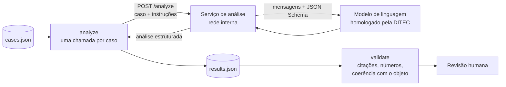

# 4. Análise semântica: contrato e regras

O parser entrega fatos verificáveis: qual dispositivo, qual operação e qual trecho literal. A redação do texto lido pela Mesa exige linguagem natural e fica a cargo de um **modelo de linguagem**. Este documento descreve o que o fluxo original pede ao modelo, o contrato que isola o pipeline da escolha do modelo e as verificações aplicadas à resposta.

## 4.1 Como a etapa funciona



- O fluxo original faz **uma chamada por destaque ou emenda** e pede resposta estruturada em JSON Schema. Usa um modelo comercial acessado por API.
- Aqui, o pipeline nunca fala diretamente com o modelo. `analyze` chama um **serviço de análise na rede interna** (`ANALYZER_URL`), e é esse serviço que escolhe e chama o modelo: interno (vLLM, Ollama, LiteLLM) ou contratado. A DITEC troca de modelo sem mexer no pipeline.
- Vão ao serviço **apenas o caso e as evidências literais**, e não os PDFs: o requerimento ou a emenda, o texto da emenda destacada, os recortes do texto-base, a expressão destacada e a redação vigente, quando capturada.
- O fluxo original também enviava um resumo curto do parecer e do texto principal. O serviço de análise pode acrescentar esse contexto, desde que as afirmações factuais continuem citando evidências.

## 4.2 Regras de redação

As instruções vão no campo `instructions` de cada chamada. São montadas por `analyze.instructions_for(case)` a partir de `BASE_RULES`, `MODE_RULES[modo]` e `ASSESSMENT_RULES`, em `src/analise_legislativa/analyze.py`. Em resumo:

**Para todo caso**

- Leitor: a Presidência da Mesa, durante a votação.
- `summary`: parágrafo único de 55 a 75 palavras. A 1ª frase diz o **efeito material**, com verbo concreto (institui, eleva, reduz, autoriza, proíbe, condiciona) e os dados exatos. Depois vêm a operação e o dispositivo. Frases de até 25 palavras, em ordem direta, numerais em algarismos.
- Dizer o que a regra manda, permite ou proíbe. Ficam proibidas fórmulas vazias ("a regra nele prevista", "o referido dispositivo") e metalinguagem ("operação legislativa", "texto normativo final").
- **Não fabricar.** Todo número, valor, prazo, setor e dispositivo precisa constar das evidências. Sem o teor necessário, o modelo descreve só o verificável e registra a lacuna em `uncertainties`.
- Só atribuir a incidência ao substitutivo se `target.text_role` disser `substitutivo`. Nomear o texto-alvo com sigla, número e data quando constarem ("o substitutivo do relator (SBT 1, de 12/05/2026)"). Comissões só por sigla.
- Nunca afirmar aprovação, rejeição, inconstitucionalidade, prejudicialidade nem vigência futura.
- Cada afirmação factual vai em `claims`, com os `evidence_ids` que a sustentam.

**Por modo**

| Modo | Abertura | Regra central | `change_kind` |
| --- | --- | --- | --- |
| `dvs` | "Pretende-se suprimir o [dispositivo], retirando do texto a regra que [conteúdo]" | dizer o que continua valendo sem o trecho; não tratar como inclusão de emenda | `supressao_pretendida` |
| `destaque_emenda` | "Pretende-se aprovar a Emenda N, que [efeito concreto]" | o texto integral da emenda é a fonte do efeito; comparar com o dispositivo atual, com os números exatos (50% para 100%); nunca descrever como supressão | `inclusao_emenda` |
| `emenda` | efeito no mérito | comparar com a redação atual | a do comando: `nova_redacao`, `acrescimo`, `supressao`, `substituicao` |
| `emenda_redacao` | antes/depois | expressões exatas e 1 frase sobre o ganho de clareza; sem mérito | `ajuste_redacao`, e `assessment = null` |

Exemplo de `summary` para o DTQ 2 do lote de `examples/` (DVS do § 2º do art. 5º do substitutivo):

> Pretende-se suprimir o § 2º do art. 5º do substitutivo, retirando do texto a regra que manda publicar o resultado da verificação em até 5 dias úteis. Sem o parágrafo, o órgão continua obrigado a verificar a integridade do documento por servidor efetivo. O texto, porém, deixa de exigir a publicação do resultado e de fixar prazo para ela.

## 4.3 O veredito de substancialidade

`assessment.category` classifica o caso. A apresentação mostra uma pergunta e uma resposta, seguidas da justificativa, tal como no fluxo original:

| `category` | Quando | Linha exibida |
| --- | --- | --- |
| `substancial_ricd` | **só destaque** vedado pelo art. 162, IV, do RICD: modifica substancialmente a proposição ou retira expressão cuja supressão inverte o sentido (um "não", uma vedação, uma ressalva) | "Altera substancialmente a proposição? (RICD, art. 162, IV) Sim." |
| `sem_ajuste_ricd` | **só destaque** cujo texto não se ajusta à proposição ou não forma sentido completo (art. 162, V): dispositivo truncado, remissão órfã | "O texto destacado ajusta-se à proposição e forma sentido completo? (RICD, art. 162, V) Não." |
| `merito` | alteração de mérito fora do art. 162, IV e V, inclusive toda emenda que altere o alcance material | "Altera o mérito da proposição? Sim." |
| `pontual` | ajusta detalhe sem alterar o alcance | "Altera pontualmente a proposição? Sim." |
| `nao` | sem efeito normativo relevante | "Altera o mérito da proposição? Não." |

- Se couberem o inciso IV e o V ao mesmo tempo, vale `substancial_ricd`. Emendas nunca recebem as duas primeiras categorias, porque o art. 162 trata de destaques. Emenda de redação não recebe veredito.
- **Justificativa** (2 a 3 frases). Compara com o texto-alvo nomeado, com o verbo da mudança no futuro do pretérito ("A MPV passaria a fixar…") e o contraste completo ("…, diferentemente do texto-base, que [regra atual]"). Se o texto-alvo não trata do ponto, diz isso.
- **Fecho orçamentário.** Só se a mudança criar ou ampliar renúncia de receita ou despesa obrigatória. A justificativa diz se o texto da emenda traz estimativa de impacto e medida de compensação. Ausentes, diz que viria sem a estimativa exigida pelo art. 113 do ADCT e sem a compensação exigida pelo art. 14 da LRF (LC 101/2000), e para no fato técnico. Compensar crédito com outros tributos é forma de uso do benefício, e não compensação fiscal. Nunca "é inconstitucional" nem "está prejudicado", e nada sobre o que a Presidência fará.

## 4.4 Contrato HTTP

`POST {ANALYZER_URL}` — especificação em [`openapi.yaml`](openapi.yaml). Autenticação opcional com `Authorization: Bearer {ANALYZER_TOKEN}`. O endereço precisa ser `localhost`, IP privado ou nome terminado em `.interno`, `.internal` ou `.local` (`analyze._internal_endpoint`).

Requisição (abreviada):

```json
{
  "schema_version": "1.0",
  "case": {
    "case_id": "e2244badc35c9fbfeb43", "source_id": "local:dtq-2", "mode": "dvs",
    "operation": "supressao_pretendida", "ricd_basis": "art. 161, I",
    "target": { "article": "5", "paragraph": "2", "text_role": "substitutivo", "…": "…" },
    "evidence": [
      { "evidence_id": "6d25739288f980e070d2", "kind": "requerimento_ou_emenda", "quote": "CÂMARA DOS DEPUTADOS …" },
      { "evidence_id": "d9e8709f9d2f626eb71e", "kind": "dispositivo", "source_id": "local:prlp-2",
        "quote": "§ 2º O resultado da verificação será publicado em até 5 dias úteis." }
    ],
    "warnings": [], "notes": ["§ 2º do art. 5º: redação diferente em versão anterior (local:prlp-1)"]
  },
  "instructions": "Você é consultor legislativo da Câmara dos Deputados e escreve para a Presidência da Mesa…"
}
```

Resposta ([`analysis.schema.json`](../src/analise_legislativa/schemas/analysis.schema.json)):

```json
{
  "schema_version": "1.0",
  "analysis": {
    "summary": "Pretende-se suprimir o § 2º do art. 5º do substitutivo, retirando do texto a regra que manda publicar …",
    "summary_evidence_ids": ["d9e8709f9d2f626eb71e"],
    "material_effect": "O texto deixaria de exigir a publicação do resultado da verificação.",
    "material_effect_evidence_ids": ["d9e8709f9d2f626eb71e"],
    "claims": [ { "text": "O § 2º fixa prazo de 5 dias úteis para publicar o resultado.", "evidence_ids": ["d9e8709f9d2f626eb71e"] } ],
    "change_kind": "supressao_pretendida",
    "assessment": { "category": "merito", "evidence_ids": ["d9e8709f9d2f626eb71e"],
                    "justification": "O substitutivo deixaria de exigir a publicação do resultado, diferentemente da versão em votação, que a exige em prazo fixo." },
    "uncertainties": []
  },
  "evidence_ids": ["6d25739288f980e070d2", "d9e8709f9d2f626eb71e"]
}
```

Respostas 429 e 5xx são repetidas até 3 vezes, respeitando `Retry-After`. Um erro definitivo marca só aquele caso como `failed`; os demais seguem. O checkpoint `.analysis.checkpoint.json` guarda cada resultado assim que ele chega. Repetir `analyze` com o mesmo lote e o mesmo endereço só refaz o que faltou; outro lote ou outro serviço invalidam o checkpoint.

## 4.5 Analisador de referência

`examples/analisador_referencia.py` implementa o contrato acima em cerca de 130 linhas, sem dependência além do pacote. Ele:

1. monta duas mensagens: sistema, com o papel e o formato, e usuário, com `instructions` e o caso em JSON;
2. chama `{LLM_BASE_URL}/chat/completions`, o formato aceito pela maioria dos servidores e provedores, com `response_format` do tipo `json_schema` estrito, derivado de `analysis.schema.json`;
3. valida a resposta contra o schema completo antes de devolvê-la, e responde 502 se o modelo sair do formato.

```bash
export LLM_BASE_URL=http://llm.interno/v1 LLM_MODEL=nome-do-modelo   # LLM_API_KEY se o provedor exigir
python examples/analisador_referencia.py                              # POST http://127.0.0.1:8080/analyze
ANALYZER_URL=http://localhost:8080/analyze analise-legislativa analyze --workspace work/demo
analise-legislativa validate --workspace work/demo
```

`LLM_EXTRA_JSON` repassa parâmetros próprios do provedor (por exemplo `{"temperature": 0}`). O teste `tests/test_reference_analyzer.py` percorre o circuito inteiro (pipeline, serviço HTTP, modelo simulado e validação) sem rede externa.

## 4.6 Validação da resposta (`validate`)

`validate` não confia no modelo. Para cada resultado, confere:

| Verificação | Falha vira |
| --- | --- |
| versão do contrato, `run_id` e conjunto de casos | erro (lotes misturados) |
| cada evidência ainda é a mesma fatia do arquivo (hash, texto e página) | aviso |
| `evidence_ids` existem; cada afirmação, a síntese, o efeito e o veredito citam evidências próprias | aviso |
| todo número citado aparece nas evidências citadas pela própria afirmação (normas notórias como "art. 113 do ADCT" e "art. 14 da LRF" são ignoradas) | aviso |
| DVS cita o dispositivo; destaque de emenda cita a emenda | aviso |
| `change_kind` coerente com o modo e a operação | aviso |
| veredito presente (exceto emenda de redação); categorias do RICD só em destaque | aviso |
| o modelo registrou incertezas | aviso |

Com aviso, o status é `review_required`; sem aviso, `pending_review`. `validation.json` sempre traz `"requires_human_review": true`: a revisão humana compara requerimento, emenda, dispositivo e texto produzido antes de qualquer uso institucional. A verificação de números e citações pega erros comuns, mas não prova que o trecho citado sustenta a afirmação.

## 4.7 Da análise ao texto lido pela Mesa

Para cada caso, a apresentação monta:

1. o cabeçalho com o objeto e o autor, a partir dos metadados ("DTQ 4: Dep. Fulano — PARTIDO/UF"; "DTQ 1 a EMP 1");
2. o `summary`;
3. a linha do veredito (tabela 4.3) seguida de `assessment.justification`.

O fluxo original agrupa os itens em "Parte 1 — Destaques" e "Parte 2 — Emendas". O meio de exibição fica a critério da solução institucional.
