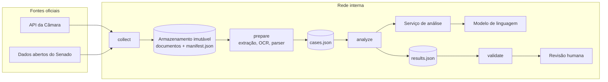

# 5. Infraestrutura e operação

## 5.1 Componentes



O código de referência roda num único processo e grava tudo na pasta `--workspace`. Para a produção, a identidade (`source_id`, `sha256`, `run_id`, `case_id`) não depende de nenhum produto de infraestrutura. Um mapeamento natural:

| Artefato | Em produção |
| --- | --- |
| `sources/` | armazenamento de objetos interno, imutável, com chave pelo `sha256` |
| `manifest.json`, `cases.json`, `results.json` | banco relacional (uma linha por documento, caso e resultado) ou documentos JSON versionados |
| uma execução por proposição | fila de tarefas; `prepare` e `analyze` em workers isolados |
| checkpoint | o próprio estado por `case_id` no banco |

## 5.2 Ambiente

| Item | Requisito |
| --- | --- |
| Python | 3.12 ou superior (CI em 3.12 e 3.13) |
| Bibliotecas | PyMuPDF, pypdf, python-docx, httpx, jsonschema (≥ 4.18) — ver `pyproject.toml` |
| OCR | Tesseract com o idioma `por`, necessário quando houver PDF digitalizado. Debian/Ubuntu: `apt-get install tesseract-ocr tesseract-ocr-por`. Fora do PATH: `TESSERACT_CMD` |
| Rede de coleta | saída HTTPS para `*.camara.leg.br`, `*.senado.leg.br` e `*.congressonacional.leg.br`, por proxy se houver |
| Rede de análise | só o endereço interno do serviço de análise (`ANALYZER_URL`); o serviço, e não o pipeline, é quem alcança o modelo |
| Disco | originais, manifesto, casos, resultados e checkpoint: o lote da MPV 1357/2026 (126 documentos) ocupa 44 MB |

O `Dockerfile` gera uma imagem Linux com Tesseract `por` e usuário sem privilégios:

```bash
docker build -t analise-legislativa .
docker run --rm --user "$(id -u):$(id -g)" -v "$PWD/work:/work" analise-legislativa \
  collect --proposicao "PL 5229/2025" --workspace /work/pl5229
```

## 5.3 Configuração

| Variável | Uso | Padrão |
| --- | --- | --- |
| `ANALYZER_URL` | endereço do serviço de análise (`localhost`, IP privado ou `.interno`/`.internal`/`.local`) | — |
| `ANALYZER_TOKEN` | enviado como `Authorization: Bearer` ao serviço | vazio |
| `TESSERACT_CMD` | executável do Tesseract | `tesseract` |
| `LLM_BASE_URL`, `LLM_MODEL`, `LLM_API_KEY`, `LLM_EXTRA_JSON`, `ANALYZER_PORT` | só o analisador de referência (`examples/`) | — |

Tokens e chaves não vão em argumento de linha de comando, no Git nem no log. `.env.example` lista as variáveis; a CLI lê o ambiente e não carrega arquivo `.env` sozinha.

## 5.4 Comandos

```bash
analise-legislativa collect  --proposicao "PEC 18/2025" --workspace work/pec18   # ou --input-dir pasta/
analise-legislativa prepare  --workspace work/pec18
analise-legislativa analyze  --workspace work/pec18        # exige ANALYZER_URL
analise-legislativa validate --workspace work/pec18
analise-legislativa run      --proposicao "PEC 18/2025" --workspace work/pec18   # as quatro etapas
```

Cada etapa imprime uma linha JSON com contagens, por exemplo `{"stage": "prepare", "run_id": "…", "cases": 55, "review_required": 1}`. `--verbose` liga o log técnico, que registra identificadores e erros e nunca o teor dos documentos. `--all-congress-amendments` baixa todas as emendas de MPV do Congresso.

| Código de saída | Significado |
| --- | --- |
| 0 | etapa concluída; casos pendentes de revisão são o resultado normal |
| 1 | `validate`: ao menos um caso com análise `failed` |
| 2 | erro que impediu a etapa (proposição não resolvida, manifesto inválido, hash divergente, endereço de análise ausente ou externo) |

## 5.5 Recuperação

- **Análise interrompida.** Repita `analyze` com o mesmo workspace e o mesmo endereço: o checkpoint devolve os casos concluídos e só os restantes são chamados.
- **Documento novo ou substituído.** Repita `collect` e `prepare`. O hash muda o `run_id`, e o checkpoint antigo deixa de valer.
- **Correção de vínculo ou de papel.** Corrija o sidecar ou acrescente o documento faltante e reconstrua o pacote. Não edite `cases.json` à mão: `validate` recusa evidência que não corresponde à fonte.
- **OCR indisponível.** O caso não fica errado em silêncio: um substitutivo mais recente ilegível gera aviso "versão mais recente indisponível" nos casos que dependem dele.

## 5.6 Capacidade e observabilidade

Medições num notebook, sem paralelismo:

| Lote | Documentos | Casos | Disco | `prepare` |
| --- | --- | --- | --- | --- |
| PL 5229/2025 | 15 | 9 | 4,6 MB | 3,5 s |
| PEC 18/2025 | 72 | 55 | 29 MB | 45 s; 88 s com OCR de um substitutivo digitalizado de 16 páginas |
| MPV 1357/2026 | 126 | 123 | 44 MB | 17 s |

A coleta leva cerca de 1 s por documento (16 s para os 15 do PL 5229/2025): são duas requisições por documento, com o intervalo de 0,5 s mantido de propósito. A análise é a etapa cara: uma chamada ao modelo por caso. A referência processa em sequência. A paralelização institucional deve preservar um limite global de requisições ao modelo e a gravação atômica por caso.

Métricas úteis por `run_id`: documentos por papel, proporção de OCR, casos por modo, casos com `review_required`, frequência de cada tipo de aviso, latência e falhas do serviço de análise. Vale alertar sobre falha repetida de fonte oficial, aumento de vínculos ambíguos, substitutivo ilegível e resposta fora do schema.
